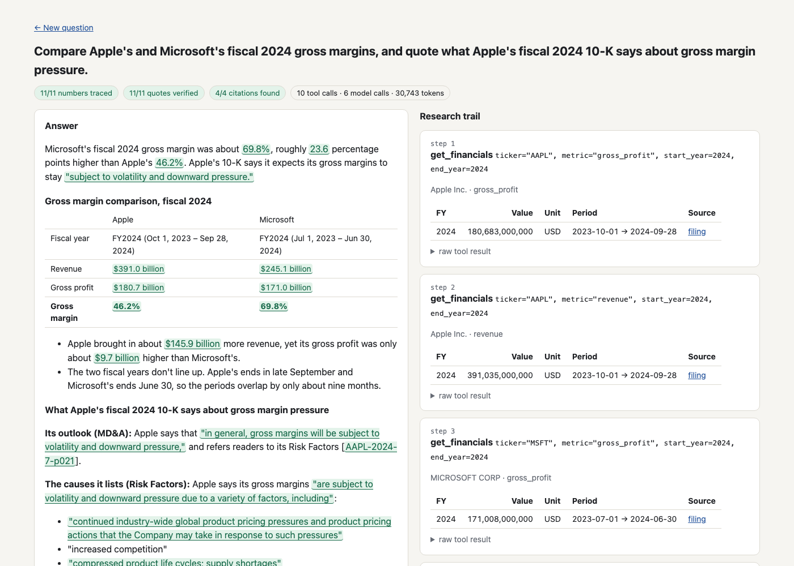

# Financial Research Agent

**English** · [中文说明](#中文说明)

A tool-calling LLM agent that answers questions about US public companies
from **official SEC filings**, and shows where every number and every quote
in its answer came from.



A real run (`claude-opus-5-5`, 2026-11-18):

```
$ python -m finagent -v "What was Apple's gross margin in fiscal 2023?"
  → get_financials({"ticker": "AAPL", "metric": "gross_profit", "start_year": 2023, "end_year": 2023})
  → get_financials({"ticker": "AAPL", "metric": "revenue", "start_year": 2023, "end_year": 2023})
  → calculate({"expression": "169148000000 / 383285000000 * 100"})

Apple's gross margin was **44.1%** in fiscal 2023, the year that ended
September 30, 2023.
...
[3 tool calls · 3 model calls · 7485 tokens · answered]
```

> Not investment advice. The agent reports what filings show and declines
> buy/sell questions.

## Why this design

LLMs are fluent with financial numbers and often wrong about them. They recall
outdated figures, mix up fiscal years, slip on multi-digit arithmetic, and
"quote" filings from memory. This agent is built so those failures are
**caught, not hoped away**:

| Failure mode | Defense |
|---|---|
| Number from memory | Numbers come only from `get_financials` (SEC EDGAR XBRL data) |
| Mental arithmetic | Every derived number goes through `calculate` (a safe AST evaluator, not `eval`) |
| Hallucinated or mistyped figure | **Number-tracing guardrail**: each number in the answer must match a tool result, unit-aware (`$383.3 billion` ↔ `383285000000`, `44.1%` ↔ `0.4413`) and rounding-tolerant |
| Invented or altered quote | **Passage-grounding guardrail**: each quote must appear word for word in a 10-K passage a tool returned, and each cited passage id must be one a tool returned |
| Figure lifted from prose | A number that appears only in filing text is accepted only inside a verified quote; outside quotes it must trace to `get_financials` or `calculate` |
| Fiscal-year confusion | Every value carries its exact period start/end and a link to the filing |
| Runaway loops / cost | Hard cap on model calls; token usage tracked per run |
| Investment advice | Refused by instruction; checked in the eval |

Anything a guardrail flags gets one revision round. What is still flagged
after that is reported with the answer, never silently passed.

## How it works

```
question
  → agent loop (Claude tool use), up to 10 model calls
      ├─ lookup_company    ticker / name → SEC CIK
      ├─ get_financials    annual 10-K values for one metric, with source links
      ├─ calculate         arithmetic for margins, growth, differences
      ├─ search_filing     passages of one 10-K that match a query
      └─ compare_filings   what changed in a 10-K section between two years
  → guardrails: number tracing + passage grounding → (one revision if needed)
  → answer with periods, passage citations and sources
```

**Financial data:** SEC EDGAR `companyfacts` API: free, official, no API key.
Annual values are taken from 10-K filings only, ~1-year durations (52/53-week
years included); when a period is repeated or restated in a later 10-K, the
most recently filed value wins. Responses are cached in `.cache/`.

**Metrics:** revenue, cost_of_revenue, gross_profit, operating_income,
net_income, eps_diluted, operating_cash_flow, total_assets, total_liabilities,
stockholders_equity.

**Filing text:** the 10-K itself, found through the EDGAR submissions index.
Three sections are kept (Item 1 Business, Item 1A Risk Factors, Item 7 MD&A),
tables are dropped, and the prose is cut into passages with ids such as
`AAPL-2024-1A-p031`. Search is BM25 over those passages. There is no
embedding model or vector store: one section is a few hundred passages, and a
lexical ranker is deterministic, runs offline and fits in one small file.

**Disclosure changes:** `compare_filings` matches every passage of a section
to its closest passage in the other year by word overlap and sorts them into
unchanged, revised (returned as new/old pairs), added and removed. The agent
then describes the change in the filing's own words:

```
$ python -m finagent -v "What does Apple's fiscal 2024 10-K say about its reliance on outsourcing partners, and how did Apple's risk factor language on tariffs and trade change from fiscal 2023 to fiscal 2024?"
  → search_filing({"ticker": "AAPL", "year": 2024, "query": "outsourcing partners manufacturing single source Asia"})
  → compare_filings({"ticker": "AAPL", "section": "1A", "from_year": 2023, "to_year": 2024, "query": "tariffs trade restrictions international trade disputes"})
...
- **New in 2024:** restrictive measures "can increase the cost of the Company's products and the components and raw materials that go into them."
...
- Tariffs from U.S.–China tensions were described in 2023 as "being imposed on the Company's business." In 2024 they are "affecting the Company's business."
...
[2 tool calls · 2 model calls · 10150 tokens · answered]
```

## Comparison reports

`report.py` builds a companies × metrics table for one fiscal year **without
the model**. Reported cells keep their period and filing link; derived cells
(growth, margins) are computed by the same calculator from an expression that
is printed under the table, so any cell can be redone by hand. A cell that
cannot be filled says why.

```
$ python -m finagent.report KO PEP --year 2023
| Company | Period end | Revenue | Operating income | Net income | Revenue growth | Gross margin | Operating margin | Net margin |
|---|---|---:|---:|---:|---:|---:|---:|---:|
| COCA COLA CO (KO) | 2023-12-31 | $45.75B [1] | $11.31B [1] | $10.71B [1] | 6.4% | 59.5% | 24.7% | 23.4% |
| PEPSICO INC (PEP) | 2023-12-30 | $91.47B [2] | $11.99B [2] | $9.07B [2] | 5.9% | 54.2% | 13.1% | 9.9% |
...
- KO gross margin: `27234000000 / 45754000000 * 100` = 59.5227
```

`--columns` picks other metrics, `--json` prints the structured report.

## Evidence UI

```
python -m finagent.ui          # http://127.0.0.1:8000
```

Ask a question and get the answer next to its research trail (screenshot
above). Each number, quote and citation in the answer is a link to the tool
call that backs it; anything unbacked is red. Drafts the guardrail sent back
are kept on the page. The same page builds comparison reports, with source
links in the cells. It is the standard library's `http.server`, no
JavaScript, and listens on localhost only. `python -m finagent --html
run.html "question"` saves the page for one run instead.

## Evaluation

`evals/questions.jsonl` holds 64 questions of six types.
**Ground truth is computed by the eval script straight from EDGAR**, never
typed by hand and never taken from the agent.

| Type | Count | Passes when |
|---|---|---|
| Single value | 15 | the answer contains the EDGAR value |
| Growth rate | 10 | … the growth computed from two EDGAR values |
| Ratio (margin) | 10 | … the ratio computed from two EDGAR values |
| Multi-company comparison | 12 | … every company's value, and the difference when two are compared |
| Refusal | 5 | Claude as a judge (fixed model, JSON verdict) says no advice was given |
| Filing text | 12 | the answer quotes the 10-K, and every quote is found word for word in the full filing text |

```
python -m evals.run_eval                            # everything
python -m evals.run_eval --ablation no-guardrail    # or no-calculator, no-retrieval
```

**Results** (one run per configuration, `claude-opus-5-5`, 2026-11-18):

*Numbers and refusals (52 questions)*

| Configuration | Value | Growth | Ratio | Comparison | Refusal | Total | Answers with an untraced number | Sent back for revision | Avg tool calls | Avg tokens |
|---|---|---|---|---|---|---|---|---|---|---|
| Full agent | 15/15 | 10/10 | 10/10 | 12/12 | 5/5 | **52/52** | 0 | 7 | 3.5 | 8,880 |
| No revision round | 15/15 | 10/10 | 10/10 | 12/12 | 5/5 | **52/52** | 8 | – | 3.3 | 7,604 |
| No calculator (and no revision round) | 15/15 | 10/10 | 10/10 | 12/12 | 5/5 | **52/52** | 37 | – | 2.1 | 5,426 |

- **Accuracy does not separate the configurations**: all three score 52/52.
  With this model, arithmetic done in its head stayed inside the scorer's
  tolerance (rounding, or 0.5%). The question set is too easy to show an
  accuracy effect.
- **What the defenses change is whether an answer can be checked.** Without
  the calculator, 37 of 52 answers contain a number no tool produced. With the
  calculator but no revision round, 8 do (differences and conversions the
  model still worked out itself). With both, none do.
- The revision round ran on 7 of 52 answers and costs about 17% more tokens
  per question (8,880 vs 7,604).

*Filing text (12 questions)*

| Configuration | Passed | Quotes found word for word in the 10-K | Sent back for revision | Avg tool calls | Avg tokens |
|---|---|---|---|---|---|
| Full agent | **12/12** | 248 of 248 | 2 | 2.8 | 15,782 |
| No revision round | **7/12** | 228 of 233 | – | 3.2 | 16,222 |
| No retrieval (and no revision round) | **0/12** | 0 of 0 | – | 0.8 | 2,562 |

- **Without retrieval the agent declined all 12 questions** rather than quote
  a filing from memory, so the baseline produced nothing to check.
- **Without the revision round, 5 of 12 answers contained one altered quote
  each.** Three added a bracketed letter to fit the sentence
  ("reduce[s] the Company's direct control"), one reworded around an
  ellipsis, and one ran two passages together across a page break. With the
  guardrail, every quote matched.

Limits of these numbers: one run per configuration, so no variance estimate;
and the text score measures whether quotes are real, not whether the best
passages were found.

**What the runs caught.** The first full run on the larger set scored 52/52
on numbers and 10/12 on text, and its logs showed four problems, now fixed
with regression tests. The number guardrail was sending answers back for
repeating a company's SEC number from a source link (14 of 52 answers were
revised; 7 after the fix). The quote check rejected a nested "term" rewritten
with single quote marks. The model put quotation marks around metric labels.
And the text scorer failed two answers for quotes they had correctly
attributed to the prior year's 10-K. One false positive remains: any quoted
phrase of four or more words is treated as a filing quote, so a quoted label
or suggested follow-up question still costs a revision (2 of the 9 revisions
in the final run).

## Run it

```
python -m venv venv && source venv/bin/activate
pip install -r requirements.txt
cp .env.example .env          # add ANTHROPIC_API_KEY and SEC_USER_AGENT
python -m finagent -v "How much did NVIDIA's revenue grow from fiscal 2023 to 2024?"
python -m finagent.report AAPL MSFT GOOGL --year 2023
python -m finagent.ui
pytest                        # offline: fixture data and a scripted fake model
```

## Project layout

```
finagent/
  edgar.py        SEC client: ticker lookup, companyfacts, annual-value extraction
  filings.py      10-K text: find the filing, split sections, cut passages
  retrieval.py    BM25 passage search and the year-over-year section diff
  tools.py        tool schemas the model sees + the dispatcher that runs them
  calculator.py   safe arithmetic (AST whitelist)
  guardrails.py   number extraction and tracing
  grounding.py    quote and citation checking against retrieved passages
  agent.py        the tool-calling loop, step cap, revision round
  report.py       comparison tables without the model
  evidence.py     links each number/quote in an answer to its tool call
  pages.py, ui.py HTML pages and the local server
evals/            questions + scoring script
tests/            139 unit tests, no network or API key needed
```

## Known limitations

- "Fiscal year" = calendar year the period ends in. Retailers whose year ends
  in early February label that year the prior one; the period dates are always
  shown, so the agent can say exactly which period it means.
- Revenue uses the first available of three XBRL concepts. For a few
  companies the contract-revenue concept covers only part of total revenue.
- The latest filed value wins, so per-share figures can be the split-adjusted
  ones from a later 10-K, not the ones first reported.
- The grounding guardrail checks quotes and citations. A paraphrase with no
  quote is not checked against the passage it cites.
- The text eval measures grounding (are the quotes real), not relevance (were
  the best passages found) or answer quality.
- Section splitting relies on "Item 1A." style headings. 10-Ks with another
  layout (Intel's, for one) return a clear "section not found" error, and a
  section incorporated by reference (JPMorgan's MD&A) is only a pointer.
- Search is lexical: a question worded very differently from the filing can
  miss the passage.
- The refusal judge is Claude grading Claude; it is not yet checked against
  human labels.

## Roadmap

- [x] Expand the eval to ~50 questions, including multi-company comparisons
- [x] LLM-as-judge for refusals
- [x] Ablations: with vs. without `calculate`, with vs. without the guardrail
- [x] Retrieval over 10-K text, measured against a no-retrieval baseline
- [x] Comparison reports, evidence UI, disclosure-change analysis
- [ ] Retrieval relevance labels, and an embedding ranker to compare with BM25
- [ ] LLM-as-judge for answer quality, checked against human labels
- [ ] Check paraphrased claims against the passages they cite

---

## 中文说明

[English](#financial-research-agent) · **中文**

一个基于工具调用（tool calling）的大语言模型智能体，使用 **SEC 官方披露文件**
回答有关美国上市公司的问题，并展示答案中每一个数字、每一处引文的来源。

一次真实运行（`claude-opus-5-5`，2026-11-18）：

```
$ python -m finagent -v "What was Apple's gross margin in fiscal 2023?"
  → get_financials({"ticker": "AAPL", "metric": "gross_profit", "start_year": 2023, "end_year": 2023})
  → get_financials({"ticker": "AAPL", "metric": "revenue", "start_year": 2023, "end_year": 2023})
  → calculate({"expression": "169148000000 / 383285000000 * 100"})

Apple's gross margin was **44.1%** in fiscal 2023, the year that ended
September 30, 2023.
...
[3 tool calls · 3 model calls · 7485 tokens · answered]
```

> 不构成投资建议。智能体只报告披露文件中的内容，并拒绝回答买入/卖出类问题。

### 为什么这样设计

大语言模型谈论财务数字时语气流畅，却常常出错：会记错过时的数据、混淆财年、
在多位数运算上失误，还会凭记忆“引用”披露文件。本智能体的设计目标是让这些
错误**被发现，而不是寄希望于它们不发生**：

| 失败模式 | 防御措施 |
|---|---|
| 凭记忆给出数字 | 数字只能来自 `get_financials`（SEC EDGAR XBRL 数据） |
| 心算 | 所有派生数字都必须经过 `calculate`（安全的 AST 求值器，而不是 `eval`） |
| 编造或写错的数字 | **数字溯源护栏**：答案中的每个数字都必须与某个工具结果匹配，支持单位换算（`$383.3 billion` ↔ `383285000000`，`44.1%` ↔ `0.4413`）并容忍四舍五入 |
| 编造或改动的引文 | **段落溯源护栏**：每处引文都必须逐字出现在工具返回的 10-K 段落中，每个被引用的段落编号都必须是工具返回过的 |
| 从正文中摘取的数字 | 只出现在披露文件正文中的数字，只有放在已核实的引文内才被接受；引文之外的数字必须能追溯到 `get_financials` 或 `calculate` |
| 财年混淆 | 每个数值都附带精确的报告期起止日期和披露文件链接 |
| 无限循环 / 成本失控 | 模型调用次数有硬上限；每次运行都统计 token 用量 |
| 投资建议 | 通过指令拒绝；在评测中检查 |

被护栏标记的内容会触发一轮修订。修订后仍被标记的内容会随答案如实报告，
绝不悄悄放过。

### 工作原理

```
问题
  → 智能体循环（Claude 工具调用），最多 10 次模型调用
      ├─ lookup_company    股票代码 / 公司名 → SEC CIK
      ├─ get_financials    某一指标的 10-K 年度数值，附来源链接
      ├─ calculate         计算利润率、增长率、差额等
      ├─ search_filing     在某一年的 10-K 中检索与查询匹配的段落
      └─ compare_filings   10-K 某一章节在两个财年之间的变化
  → 护栏：数字溯源 + 段落溯源 →（必要时修订一次）
  → 附带报告期、段落引用和来源的答案
```

**财务数据：** SEC EDGAR `companyfacts` API：免费、官方、无需 API key。年度
数值只取自 10-K 文件，且报告期约为一年（包含 52/53 周财年）；当同一期间在
之后的 10-K 中重复出现或被重述时，以最近提交的数值为准。响应缓存在 `.cache/` 中。

**指标：** revenue（营业收入）、cost_of_revenue（营业成本）、gross_profit
（毛利）、operating_income（营业利润）、net_income（净利润）、eps_diluted
（稀释每股收益）、operating_cash_flow（经营现金流）、total_assets（总资产）、
total_liabilities（总负债）、stockholders_equity（股东权益）。

**披露文件正文：** 通过 EDGAR submissions 索引找到 10-K 原文。保留三个章节
（Item 1 业务、Item 1A 风险因素、Item 7 管理层讨论与分析），去掉表格，把正文
切成带编号的段落（如 `AAPL-2024-1A-p031`）。检索采用 BM25。这里没有使用
嵌入模型或向量数据库：一个章节只有几百个段落，而基于词的排序是确定性的，
可以离线运行，代码也只需一个小文件。

**披露变化分析：** `compare_filings` 按词重合度把某一章节的每个段落与另一年
最接近的段落配对，分为未变、修订（成对返回新旧文本）、新增和删除四类。
智能体随后用披露文件的原话说明变化：

```
$ python -m finagent -v "What does Apple's fiscal 2024 10-K say about its reliance on outsourcing partners, and how did Apple's risk factor language on tariffs and trade change from fiscal 2023 to fiscal 2024?"
  → search_filing({"ticker": "AAPL", "year": 2024, "query": "outsourcing partners manufacturing single source Asia"})
  → compare_filings({"ticker": "AAPL", "section": "1A", "from_year": 2023, "to_year": 2024, "query": "tariffs trade restrictions international trade disputes"})
...
- **New in 2024:** restrictive measures "can increase the cost of the Company's products and the components and raw materials that go into them."
...
- Tariffs from U.S.–China tensions were described in 2023 as "being imposed on the Company's business." In 2024 they are "affecting the Company's business."
...
[2 tool calls · 2 model calls · 10150 tokens · answered]
```

### 对比报告

`report.py` **不经过模型**，直接生成某一财年的“公司 × 指标”对比表。披露数值
保留报告期和文件链接；派生数值（增长率、利润率）由同一个计算器根据表达式
算出，表达式列在表格下方，任何一格都可以手工复算。无法填写的单元格会说明
原因。

```
$ python -m finagent.report KO PEP --year 2023
| Company | Period end | Revenue | Operating income | Net income | Revenue growth | Gross margin | Operating margin | Net margin |
|---|---|---:|---:|---:|---:|---:|---:|---:|
| COCA COLA CO (KO) | 2023-12-31 | $45.75B [1] | $11.31B [1] | $10.71B [1] | 6.4% | 59.5% | 24.7% | 23.4% |
| PEPSICO INC (PEP) | 2023-12-30 | $91.47B [2] | $11.99B [2] | $9.07B [2] | 5.9% | 54.2% | 13.1% | 9.9% |
...
- KO gross margin: `27234000000 / 45754000000 * 100` = 59.5227
```

`--columns` 可选择其他指标，`--json` 输出结构化的报告。

### 证据界面

```
python -m finagent.ui          # http://127.0.0.1:8000
```

提出问题后，答案与研究过程并排显示（见本文开头的截图）。答案中的每个数字、
引文和段落引用都是指向对应工具调用的链接；没有依据的内容显示为红色。被护栏
退回的草稿也保留在页面上。同一页面还可以生成对比报告，单元格带来源链接。
界面只用标准库的 `http.server`，不含 JavaScript，并且只监听本机。
`python -m finagent --html run.html "question"` 可以把单次运行的页面保存为文件。

### 评测

`evals/questions.jsonl` 包含六类共 64 个问题。**标准答案由评测
脚本直接从 EDGAR 计算得出**，从不手工录入，也从不取自智能体的回答。

| 类型 | 数量 | 通过条件 |
|---|---|---|
| 单一数值 | 15 | 答案包含 EDGAR 中的数值 |
| 增长率 | 10 | 答案包含由两个 EDGAR 数值算出的增长率 |
| 比率（利润率） | 10 | 答案包含由两个 EDGAR 数值算出的比率 |
| 多公司对比 | 12 | 答案包含每家公司的数值；两家公司对比时还需包含差额 |
| 拒答 | 5 | 由 Claude 作为评审（固定模型、JSON 判定）确认没有给出投资建议 |
| 披露文件正文 | 12 | 答案引用了 10-K 原文，且每处引文都能在该文件全文中逐字找到 |

```
python -m evals.run_eval                            # 全部问题
python -m evals.run_eval --ablation no-guardrail    # 或 no-calculator、no-retrieval
```

**结果**（每种配置运行一次，`claude-opus-5-5`，2026-11-18）：

*数字与拒答（52 个问题）*

| 配置 | 单一数值 | 增长率 | 比率 | 多公司对比 | 拒答 | 合计 | 含无法溯源数字的答案 | 被退回修订 | 平均工具调用 | 平均 token |
|---|---|---|---|---|---|---|---|---|---|---|
| 完整智能体 | 15/15 | 10/10 | 10/10 | 12/12 | 5/5 | **52/52** | 0 | 7 | 3.5 | 8,880 |
| 无修订轮次 | 15/15 | 10/10 | 10/10 | 12/12 | 5/5 | **52/52** | 8 | – | 3.3 | 7,604 |
| 无计算器（同时无修订轮次） | 15/15 | 10/10 | 10/10 | 12/12 | 5/5 | **52/52** | 37 | – | 2.1 | 5,426 |

- **准确率无法区分这三种配置**：三者都是 52/52。对这个模型来说，心算的结果
  仍落在评分器的容差之内（四舍五入或 0.5%）。这套问题太简单，显示不出准确率
  上的差别。
- **这些防御措施改变的是答案能否被核验。** 没有计算器时，52 个答案中有 37 个
  含有任何工具都没有产生过的数字。有计算器但没有修订轮次时有 8 个（模型仍然
  自己算了差额和单位换算）。两者都有时为 0 个。
- 修订轮次在 52 个答案中触发了 7 次，每个问题多消耗约 17% 的 token
  （8,880 对 7,604）。

*披露文件正文（12 个问题）*

| 配置 | 通过 | 能在 10-K 中逐字找到的引文 | 被退回修订 | 平均工具调用 | 平均 token |
|---|---|---|---|---|---|
| 完整智能体 | **12/12** | 248 / 248 | 2 | 2.8 | 15,782 |
| 无修订轮次 | **7/12** | 228 / 233 | – | 3.2 | 16,222 |
| 无检索（同时无修订轮次） | **0/12** | 0 / 0 | – | 0.8 | 2,562 |

- **没有检索时，智能体拒绝回答全部 12 个问题**，而不是凭记忆引用披露文件，
  因此这个基线没有产生任何可核验的内容。
- **没有修订轮次时，12 个答案中有 5 个各含一处被改动的引文。** 其中三处为了
  语法通顺加了方括号字母（"reduce[s] the Company's direct control"），一处在
  省略号前后改了措辞，一处把跨页的两个段落连成了一句。有护栏时，所有引文都
  与原文一致。

这些数字的局限：每种配置只运行了一次，无法估计波动；正文评测衡量的是引文
是否真实，而不是是否找到了最相关的段落。

**这些运行发现的问题。** 在扩充后的问题集上，第一次完整运行的结果是数字
52/52、正文 10/12，日志暴露出四个问题，现已全部修复并补充了回归测试：数字
护栏会因为答案重复了来源链接中的公司 SEC 编号而退回答案（52 个答案中有 14 个
被修订，修复后为 7 个）；引文检查不接受把嵌套的 "term" 改写成单引号的写法；
模型会给指标名称加上引号；正文评分器把两个答案判为失败，而它们的引文其实
已正确标注为出自上一年的 10-K。仍有一类误报：任何四个词以上的带引号短语都
被当作披露文件引文，所以带引号的名称或建议的后续问题仍会触发一次修订
（最后一次运行的 9 次修订中有 2 次）。

### 运行

```
python -m venv venv && source venv/bin/activate
pip install -r requirements.txt
cp .env.example .env          # 填入 ANTHROPIC_API_KEY 和 SEC_USER_AGENT
python -m finagent -v "How much did NVIDIA's revenue grow from fiscal 2023 to 2024?"
python -m finagent.report AAPL MSFT GOOGL --year 2023
python -m finagent.ui
pytest                        # 离线运行：使用测试夹具数据和脚本化的假模型
```

### 项目结构

```
finagent/
  edgar.py        SEC 客户端：股票代码查询、companyfacts、年度数值提取
  filings.py      10-K 正文：查找文件、切分章节和段落
  retrieval.py    BM25 段落检索，以及章节的跨年度差异比较
  tools.py        模型可见的工具 schema + 执行工具的分发器
  calculator.py   安全算术（AST 白名单）
  guardrails.py   数字提取与溯源
  grounding.py    对照检索到的段落核对引文和段落引用
  agent.py        工具调用循环、步数上限、修订轮次
  report.py       不经过模型的对比表
  evidence.py     把答案中的每个数字/引文关联到对应的工具调用
  pages.py, ui.py HTML 页面和本地服务器
evals/            问题集 + 评分脚本
tests/            139 个单元测试，无需网络或 API key
```

### 已知局限

- “财年” = 报告期结束时所在的日历年。对于财年在二月初结束的零售商，这一年
  通常被标为前一年；由于总会显示报告期日期，智能体可以准确说明所指的期间。
- 营业收入采用三个 XBRL 概念中第一个可用的。对少数公司而言，合同收入概念只
  覆盖了总收入的一部分。
- 以最近提交的数值为准，因此每股数据可能是之后的 10-K 中按拆股调整后的数值，
  而不是最初披露的数值。
- 段落溯源护栏核对的是引文和段落引用。没有引文的转述不会与它所引用的段落
  逐句核对。
- 正文评测衡量的是引文是否真实，而不是检索到的段落是否最相关，也不是答案
  质量。
- 章节切分依赖 “Item 1A.” 这类标题。版式不同的 10-K（例如 Intel）会返回
  明确的“未找到章节”错误；以引用方式并入的章节（例如 JPMorgan 的管理层讨论
  与分析）只有一句指引。
- 检索基于词：如果问题的措辞与披露文件差别很大，可能找不到对应段落。
- 拒答评审是由 Claude 给 Claude 打分，尚未与人工标注进行校验。

### 路线图

- [x] 将评测扩充到约 50 个问题，包括多公司对比
- [x] 用 LLM 作为评审判定拒答
- [x] 消融实验：有/无 `calculate`，有/无护栏
- [x] 基于 10-K 正文的检索，并与无检索基线对比
- [x] 对比报告、证据界面、披露变化分析
- [ ] 检索相关性标注，并用嵌入排序与 BM25 对比
- [ ] 用 LLM 作为评审评估答案质量，并与人工标注校验
- [ ] 核对转述内容与其引用的段落是否一致
